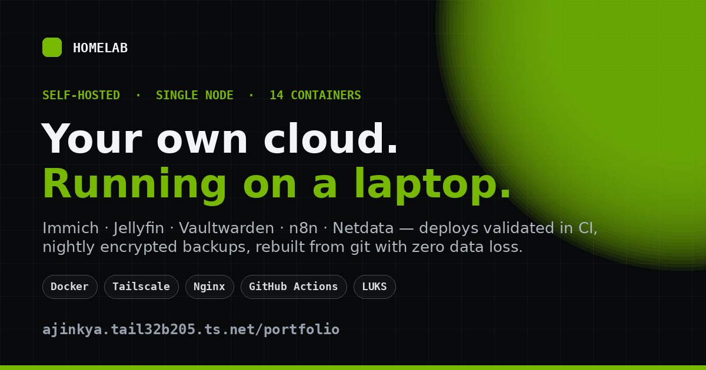
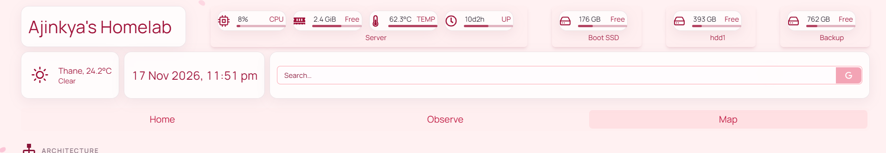
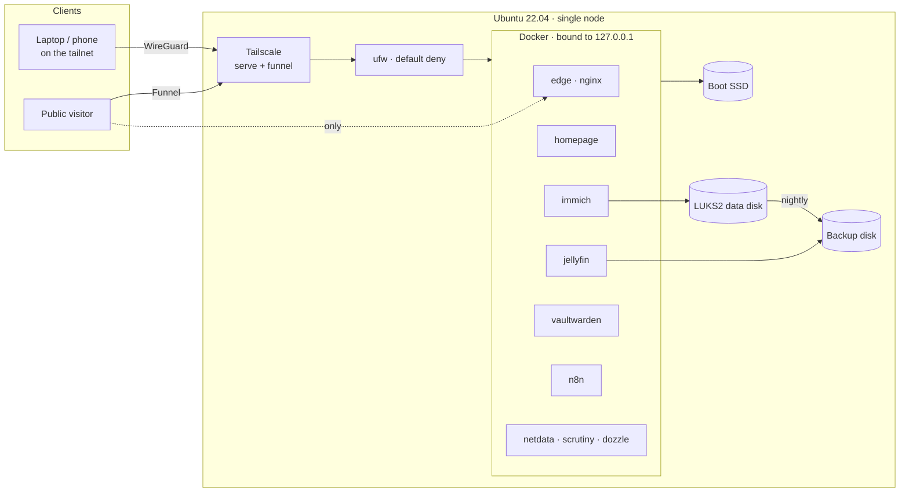

<div align="center">



# Home-Lab

**A single-node, git-defined private cloud.**
Photos, media, passwords and automation on one recycled laptop — private by default, rebuilt from git.

[](https://github.com/Ajinkya1835/Home-Lab/actions/workflows/check.yml)
[](https://github.com/Ajinkya1835/Home-Lab/actions/workflows/pages.yml)


[Live demo](https://ajinkya1835.github.io/Home-Lab/) · [Architecture](docs/architecture.md) · [Runbook](docs/runbook.md) · [Security model](docs/security.md)

</div>

---

## Highlights

| | |
|---|---|
| **Private by default** | Every container binds to `127.0.0.1`. Access is through [Tailscale](https://tailscale.com); `ufw` is default-deny and only opens `tailscale0`. |
| **One public door, by design** | Only a static portfolio (`edge`, nginx) is meant for the internet, via Tailscale Funnel. Everything with credentials stays tailnet-only. |
| **Rebuilt from git** | Each service is a Compose stack in [`docker/`](docker). Secrets never enter git: `.env.example` carries names only. |
| **CI-validated** | Every push validates all Compose files, lints shell, scans for secrets (gitleaks) and for leaked private addresses. |
| **Encrypted data disk** | Photos live on a LUKS2 (AES-XTS-512) disk; backups run nightly to a second drive. |
| **Observable** | Netdata for metrics, Dozzle for logs, Scrutiny for S.M.A.R.T. disk health, Homepage as the front door. |

<div align="center">

</div>

## What's running

| Stack | Purpose | Local port | Exposure |
|---|---|---|---|
| [`homepage`](docker/homepage) | Dashboard & status widgets | 3030 | tailnet |
| [`immich`](docker/immich) | Photo & video library (server, Postgres/vectorchord, Valkey) | 2283 | tailnet |
| [`jellyfin`](docker/jellyfin) | Media server, VAAPI transcoding | 8096 | tailnet |
| [`vaultwarden`](docker/vaultwarden) | Password manager, signups disabled | 8081 | tailnet |
| [`n8n`](docker/n8n) | Workflow automation | 5678 | tailnet |
| [`netdata`](docker/netdata) | Host & container metrics | 19999 | tailnet |
| [`scrutiny`](docker/scrutiny) | S.M.A.R.T. disk health | 8085 | tailnet |
| [`dozzle`](docker/dozzle) | Live container logs | 8888 | tailnet |
| [`filebrowser`](docker/filebrowser) | Web file manager (backup mount read-only) | 8092 | tailnet |
| [`edge`](docker/edge) | Static portfolio ([`demo/`](demo)) | 8480 | **public (Funnel)** |

## Architecture



More detail, including the deploy loop, in [`docs/architecture.md`](docs/architecture.md).

## Quick start

```bash
git clone https://github.com/Ajinkya1835/Home-Lab.git && cd Home-Lab

make validate        # lint every Compose file (needs Docker + Compose v2)
make up              # create .env from .env.example per stack, then start in dependency order
```

Then, once per host:

```bash
sudo ./host/ufw.sh                 # default-deny firewall, tailscale0 only
sudo ./host/tailscale-serve.sh     # tailnet-only HTTPS for every service, Funnel for `edge` only
sudo cp host/sshd_config.d/10-hardening.conf /etc/ssh/sshd_config.d/   # after your SSH key works
```

> Edit each `docker/<stack>/.env` before the first start (Immich DB password, Vaultwarden domain, etc.).
> `docker/homepage/config/*.yaml` use `homelab.example.ts.net` placeholders - swap in your own tailnet name.

## Repository layout

```text
.
├── docker/              one folder per stack: compose.yaml + .env.example
├── host/                firewall, Tailscale serve/funnel, SSH and fail2ban hardening
├── scripts/validate.sh  same validation CI runs
├── examples/            standalone Homepage compose + status-publisher script
├── demo/                static portfolio site (published to GitHub Pages)
├── docs/                architecture, security model, runbook
├── Makefile             validate · up · down · pull · ps
└── .github/             CI (check), Pages deploy, Dependabot
```

## Operations

| When | Job |
|---|---|
| every 5 min | `deploy` — pull, validate, recreate only stacks whose Compose hash changed |
| 03:00 | `backup` — nightly to the backup disk |
| 03:30 | `server-doc` — host inventory |
| 03:40 | `sync-config` — live config into git (refuses to commit anything that looks like a secret) |
| 08:00 | `status-digest` — morning summary |

Recovery steps live in the [runbook](docs/runbook.md).

## Security model

1. **Network:** no service listens on a public interface; the firewall only admits `tailscale0`.
2. **Exposure:** the internet sees one static site. Anything holding credentials stays tailnet-only.
3. **Containers:** `no-new-privileges`, log rotation, `cap_drop: [ALL]` on services that don't need capabilities, and a `*_VERSION` variable per stack so images can be pinned.
4. **Secrets:** never in git; `gitleaks` on every push; CI fails on private IPs or tailnet names.
5. **Host:** hardening profiles in [`host/`](host) (key-only SSH, `fail2ban`, firewall), unattended security updates, S.M.A.R.T. monitoring.

Details and the reasoning behind each choice: [`docs/security.md`](docs/security.md).

## Hardware

| | |
|---|---|
| Host | HP Laptop 15s (AMD Ryzen, Radeon iGPU), 6 GB RAM, 2 GB swap |
| Boot | 256 GB SSD |
| Data | 500 GB HDD, LUKS2-encrypted |
| Backup | 1 TB HDD |
| OS | Ubuntu 22.04 LTS |

## Roadmap

- [ ] Off-site, encrypted backup copy (restic → object storage)
- [ ] Put the Docker socket behind a read-only socket proxy
- [ ] Pin every image to a digest and let Dependabot propose bumps
- [ ] Alerting: Netdata → push notification on disk, temperature and backup failures
- [ ] Upgrade host to Ubuntu 24.04 LTS

## License

[MIT](LICENSE)
