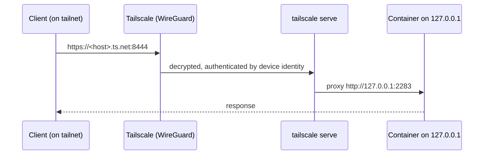
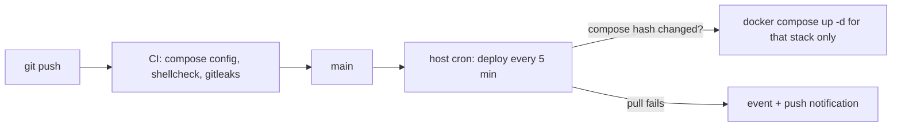

# Architecture

## Request path

Public visitors take the same path through **Funnel**, but only the `edge` container is mapped
to it.

## Deploy loop

## Storage

| Mount | Device | Use |
|---|---|---|
| `/` | SSD | OS, Docker, app configs |
| `/mnt/hdd1` | LUKS2 HDD | Immich library, personal files |
| `/mnt/backup` | HDD | Nightly backups, media library, read-only file share |

## Network layout

`homepage` joins the per-stack networks (`immich_default`, `jellyfin_default`, `netdata_default`,
`scrutiny_default`) so it can query widget APIs by container name. No other stack joins another's
network, which keeps the dependency graph acyclic: `homepage` is always started last.
